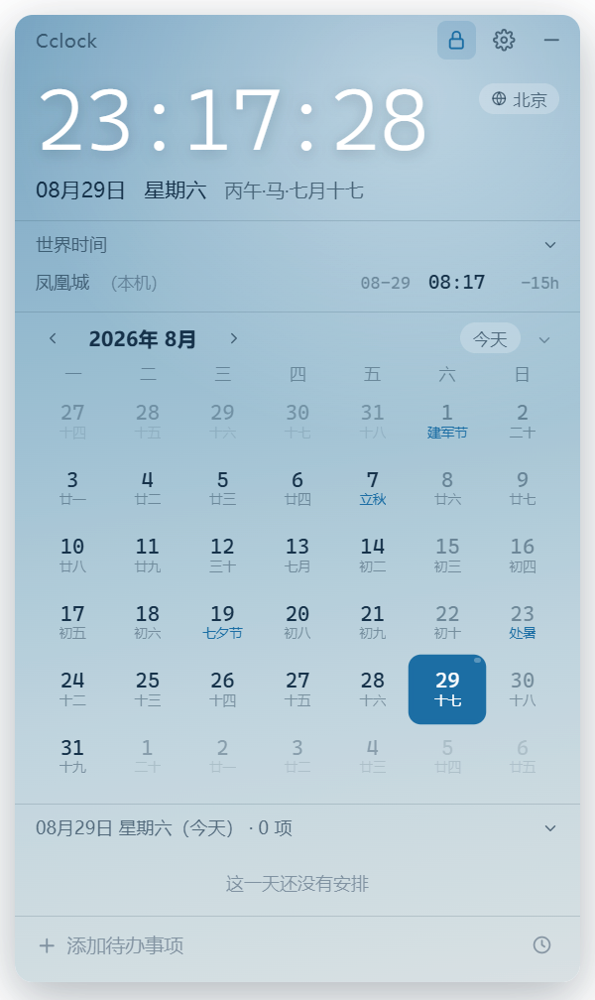
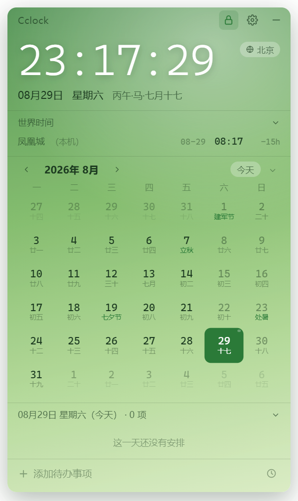

# Cclock

常驻 Windows 桌面的无边框悬浮小窗，把**跨时区时间**、**中式月历**、**带时间的待办**压在一个竖长条里。

**完全离线**：没有后端、没有数据库、不发任何网络请求。

- 版本：1.2.0
- 开发者：**AI创赛贯通社**
- 平台：Windows 10 / 11（x64）
- 实现依据：[PRD.md](PRD.md)



---

## 目录

- [它解决什么问题](#它解决什么问题)
- [安装](#安装)
- [上手](#上手)
- [功能](#功能)
- [设置](#设置)
- [主题](#主题)
- [自定义背景图](#自定义背景图)
- [导入课表](#导入课表)
- [数据与备份](#数据与备份)
- [常见问题](#常见问题)
- [开发](#开发)
- [打包与分发](#打包与分发)
- [工程结构](#工程结构)
- [许可与素材声明](#许可与素材声明)

---

## 它解决什么问题

市面上的桌面时钟默认「系统时区即真理」。如果你人在国外、作息却挂在国内（或者反过来），
就会出现：**看到的日期是"人在的地方"的日期，而心里在过的是另一个日期**，排待办时还得
在脑子里做时差换算，很容易排错日子。

Cclock 的第一性原则：

> **主时区是你指定的那个，系统时区退居为参考信息。**

应用内一切「日期」和「时间」语义都以主时区为准 —— 大时钟、日期行、月历的「今天」高亮、
待办的日期归属、过期判定，全部如此。系统时区只作为副时区那一行的参考展示，并标注时差。

---

## 安装

从 [GitHub Releases 下载 Cclock 1.2.0 安装包](https://github.com/bjwlxyzhuzhu/Cclock/releases/download/v1.2.0/Cclock-1.2.0-setup.exe)，然后：

1. 双击 `Cclock-1.2.0-setup.exe`
2. 选择安装目录（默认 `%LOCALAPPDATA%\Programs\Cclock`），**不需要管理员权限**
3. 安装完成后自动启动，并在桌面和开始菜单创建快捷方式

> **Windows 会弹蓝色 SmartScreen 警告**（"Windows 已保护你的电脑"）。
> 这是因为程序没有购买代码签名证书，不是病毒。点「更多信息 → 仍要运行」即可。
> 发给别人时记得提前说明这一点。

**卸载**：控制面板 → 程序和功能 → Cclock。卸载会一并清掉开机自启的注册表项，
但**不会删除你的数据**（见[数据与备份](#数据与备份)）。

---

## 上手

装完第一次运行，出厂设置是这样的：

| 项 | 默认值 |
|---|---|
| 主时区 | **北京**（`Asia/Shanghai`） |
| 副时区 | **系统时区**一条，界面上标「（本机）」 |
| 全局快捷键 | **`Alt+B`**（显示 / 隐藏窗口） |
| 开机自启 | 开 |
| 主题 / 透明度 | 天空 / 0.85 |
| 时间格式 | 24 小时制，显示秒 |

窗口出现在**主显示器右上角**。三件事需要先知道：

1. **它不在任务栏里**（这是刻意的，桌面挂件不占任务栏），所以别去任务栏找。
2. **默认不置顶**，可能被浏览器等窗口盖住。按 `Alt+B` 或点托盘图标唤出；
   想让它一直浮在最上面，托盘右键勾选「总在最前」。
3. **点窗口的「—」只是收进托盘，不是退出**。真正退出要用托盘右键菜单 →「退出」。
   第一次收起时会弹一次气泡提示，之后不再提示。

托盘图标是一个浅蓝色圆角时钟；**有逾期未完成待办时会叠一个小红点**。

---

## 功能

### 大时钟（常驻，不可折叠）

```
23:17:28                       🌐 北京
08月29日  星期六  丙午·马·七月十七
```

- 等宽数字 + `tabular-nums`，秒跳动时宽度不抖
- 日期行含**干支、生肖、农历**；当天是节气时农历位置改显节气名并高亮（如「处暑」）
- 右上角是主时区标签，**点一下可快速切换主时区**
- 秒针用对齐整秒边界的 `setTimeout` 驱动，不用 `setInterval`（不会累积漂移），
  系统休眠唤醒后立刻强制刷新

### 副时区（可折叠）

```
凤凰城（本机）    08-29  08:17   −15h
```

- 跟随系统时区的那条标「（本机）」
- 时差**以主时区为基准实时计算**，自动跟随夏令时，不是硬编码
- 日期与主时区不同的行，日期部分用不同颜色提示「不是同一天」
- 最多可再加 5 个城市

### 月历（可折叠）

- 7 列 × 6 行**固定网格**，切换月份时窗口高度不跳动
- 每格小字优先级：**法定节日 > 节气 > 农历初一显示「X月」> 农历日**
- 高亮的「今天」永远是**主时区的今天**
- 法定节假日标绿色「休」角标，调休上班日标橙色「班」角标
- 有待办的日子显示圆点：有未完成 = 实心，全部完成 = 空心
- **点标题栏任意处折叠 / 展开**（`◀ ▶` 和「今天」按钮除外）

### 待办（可折叠）

- 点月历某天，待办区切到该天；底部常驻输入框，回车即添加
- 支持**快捷解析**：输入 `明天 15:00 开会`、`下周三 体检`、`今天下午3点半 打电话`
  会自动拆出日期和时间；认不出就原样当标题，不瞎猜
- 颜色状态就是唯一的提醒机制（**不做系统通知弹窗**）：

  | 状态 | 判定 | 样式 |
  |---|---|---|
  | 即将到来 | 距设定时间 ≤ 30 分钟（可调） | 橙色，左侧竖条 |
  | 已过期 | 已过设定时间且未完成 | 红色，并**置顶到当日列表最上方** |
  | 已完成 | 勾选后 | 划线 + 淡化 |

- 勾完当天**仍留在列表里**（保留成就感）；过了主时区的午夜，昨日及更早的已完成项
  自动收进「已完成」折叠区，**永不自动删除**
- 逾期项不会自动挪到今天，但今日视图顶部会出现汇总条 `⚠ 有 N 项逾期未完成`，
  同时托盘图标出现红点
- 双击标题行内编辑；删除后 3 秒内可「撤销」

### 窗口行为

- 无边框、透明背景、圆角 + 投影，拖标题栏移动
- **锁定位置**后拖不动（同时移除拖拽区并调用 `setMovable(false)`，双保险）
- 折叠分区时窗口高度自适应，**上边缘位置保持不变**（向下伸缩）；
  展开后若底部超出屏幕会自动向上顶，保证完整可见
- 退出时记住位置，启动时恢复。**恢复前会校验坐标是否落在当前任一显示器的可见区域**，
  外接屏拔掉后不会出现「程序启动了但看不见」
- 单实例：重复启动只唤出已有窗口

---

## 设置

托盘右键 →「设置…」，或点标题栏的齿轮。分六组：

| 分组 | 内容 |
|---|---|
| **时间** | 主时区（可搜索，支持中文城市名 / IANA 标识）、副时区增删排序、24/12 小时制、显示秒 |
| **日历** | 每周起始日（周一 / 周日）、显示农历、显示「休 / 班」角标 |
| **待办** | 「即将到来」阈值（分钟）、是否显示「已完成」折叠区 |
| **外观** | 主题（6 套）、透明度滑块、**自定义背景图（带裁剪）** |
| **窗口** | 锁定位置、总在最前、开机自启、全局快捷键（可录制，冲突时红字提示） |
| **数据** | 数据文件路径、在资源管理器中打开、导出 JSON、导入 JSON、**导入课表** |

### 关于切换主时区

待办的日期和时间**存的是主时区下的墙钟时间字符串**（`"2026-08-30"` / `"15:00"`），
不转成 UTC。因为你心里想的「周四下午 3 点开会」指的就是主时区的 3 点；
若存 UTC，一旦换主时区所有待办的显示时间会整体漂移，反直觉。

代价是：**切换主时区后，已有待办的时间数字保持不变**（原来的 15:00 还是 15:00，
只是换了个时区的 15:00）。切换时会弹一次确认提示说明这件事。

### 关于全局快捷键

默认 `Alt+B`。如果**被别的程序占用**，注册会失败 —— 此时窗口顶部会出现一条
**红色提示条**明确告诉你（不会静默失败），设置页里也会显示红字。
换一个组合：设置 → 窗口 → 全局快捷键 →「录制」，按下新组合键即可，成功会显示绿色「已生效」。

> 别用 `Alt+Space` —— 那是 Windows 的系统窗口菜单快捷键，程序会直接拒绝并提示。

---

## 主题

内置 6 套配色 + 1 套自定义图片，全部靠 `src/styles/themes.css` 里的 CSS 变量切换：

| 值 | 名称 | 说明 |
|---|---|---|
| `sky` | 天空 | 默认，青蓝天空渐变 |
| `dusk` | 晚霞 | 暖橙紫 |
| `grass` | 草绿 | 清爽自然 |
| `huangzhong` | 黄忠·战弓 | 暗红鎏金战场配色 + 右下角射手剪影水印 |
| `dark` | 暗色 | 深灰近黑 + 弱蓝强调 |
| `plain` | 纯色 | 无渐变，跟随系统明暗，最省资源 |
| `custom` | 自定义图片 | 用你自己的图片当背景，见下一节 |

| 草绿 | 黄忠·战弓 |
|---|---|
|  |  |

**透明度只作用在背景层**（`.card__bg` 的 `--bg-opacity`），文字层始终完全不透明 ——
绝不用 `win.setOpacity()`，那会把文字一起变淡、可读性急剧下降。

> 暗色系主题（`dark` / `huangzhong`）在低透明度下会显得发灰，那是桌面壁纸透上来了，
> 不是配色错了。想让这两套出效果，把透明度拉到 **0.9 以上**。

---

## 自定义背景图

设置 → 外观 → **自定义背景图 → 上传图片…**

支持 png / jpg / webp / bmp / gif，原图上限 20 MB。选好图后会弹出裁剪框：

- **裁剪框的长宽比锁定为主窗口卡片的当前尺寸**（380 × 当前高度），
  所以裁出来的图放进窗口是刚好铺满、不会变形也不会留白
- 拖动图片调位置，**滚轮或滑块缩放**（以鼠标位置为锚点），框外区域压暗，实时预览
- 「铺满」按钮一键回到刚好铺满裁剪框的最小缩放
- 图片边缘不允许被拖进框内，不会出现露底

确认后自动切到 `custom` 主题。图片以 PNG 存在 `%APPDATA%\Cclock\background.png`，
按窗口尺寸的 2 倍像素导出，高分屏下也清晰。

因为图片内容不可预知，`custom` 主题的文字统一用**白色 + 投影**，
背景上还压了一层上下渐变的暗罩，保证任何图上都读得清。

> 窗口高度会随分区折叠变化，裁剪时用的是**当时**的高度。
> 背景用 `cover` 铺，高度变了也不会变形，只是上下会多裁掉一点。
> 想精确匹配某个高度，就先把分区调成那个状态再上传。

清除：同一行的「清除」按钮，会删掉图片文件并切回天空主题。

---

## 导入课表

设置 → 数据 → **导入课表…**

支持教务系统导出的 `.xls` / `.htm` 课表 —— 那种文件名叫 `.xls`、
内容其实是一张 HTML 表格的东西（常见 GBK 编码，程序会自动识别）。

### 它怎么读

课表格子里长这样：

```
人工智能概论(25114917.55) (2026级智能制造工程1班 …) (4-11,综合楼406(石鼓校区))
└─ 课程名 ──┘└─ 课程号 ─┘  └───── 教学班 ─────┘  └周次┘└─── 地点 ───┘
```

- 格子位置**不按肉眼顺序数**，而是读单元格自带的 `id="TD{星期}{节次}_0"`，
  因为「第三-四节」这类课是跨行合并的，按位置数必错
- `rowspan` 还原成「第 N-M 节」
- 周次支持 `1-4`、`4-11`、`3,5,7`、`1-16(单)`、`1-8双`、`1-4,9-10`
- 课程名里自带括号（如 `数据结构(实验)`）也能正确剥开
- 认不出格式的格子会跳过并计入警告，**不猜**

### 导入前要你给两样东西

课表里只有「第几周」，没有这一周对应哪天；也没有每节课的具体时间。
这两件事程序推不出来，所以做成了表单项：

| 项 | 说明 |
|---|---|
| **第 1 周的周一是哪天** | 必填。选了非周一会自动往前对齐到那周的周一 |
| **节次时间表** | 十节课的开始时间，给了一套常见默认值，按你学校的作息改 |

还有两个开关：

- **标题里带上教室** —— 关掉后待办只显示「课程名 · 第N-M节」
- **重新导入时替换旧课表** —— 开启后先删掉上次导入的全部课程待办再写入新的，
  避免重复。**手动添加的待办不受影响**（靠待办上的 `source: "schedule"` 标记区分）

对话框底部实时显示「将生成 N 条待办（起始日 ~ 结束日）」，确认无误再点导入。

### 导入后

每节课变成一条**带日期和时间的待办**，标题形如
`人工智能概论 · 第5-6节 · 综合楼606(石鼓校区)`，
自动出现在月历对应日子的圆点里，也会照常参与「即将到来」变橙、「已过期」变红的提醒。

> 实测：一份含 10 条上课安排的课表（`前沿技术与学科发展讲座` 1-4 周、
> `人工智能概论` 4-11 周）导入后生成 64 条待办。

---

## 数据与备份

- 路径：`%APPDATA%\Cclock\data.json`（自定义背景图另存为同目录的 `background.png`）
- **明文、带缩进的 JSON**，可以直接用文本编辑器改
- 写入策略：写临时文件后**原子重命名**，避免写一半崩溃损坏数据；
  变更后 debounce 500ms 落盘，退出时强制落盘
- 文件不存在 → 用默认值创建
- JSON 解析失败 → 把损坏文件重命名为 `data.corrupted.<时间戳>.json`，
  用默认值重建，并在界面上提示一次

**导出 / 导入**：设置 → 数据。导入前会自动把现有文件备份为同目录下的 `data.backup.json`。

**卸载不会删数据。** 想彻底清干净，手动删掉 `%APPDATA%\Cclock` 目录。

> 历史遗留：程序早期叫「桌面时钟」，数据在 `%APPDATA%\桌面时钟`。
> 改名 Cclock 后首次启动会**自动把旧数据搬过来**（仅在新目录还是空的时候做一次），
> 老目录保留不动，确认没问题后可以自己删掉。

---

## 常见问题

**Q：装完找不到窗口？**
A：它不在任务栏。默认在主显示器右上角，且默认不置顶可能被盖住。按 `Alt+B`，
或点托盘区那个浅蓝色时钟图标。

**Q：按 `Alt+B` 没反应？**
A：多半被别的程序占用了。看窗口顶部有没有红色提示条，去设置里换一个组合键。

**Q：点了「—」程序就没了？**
A：那是收进托盘，程序还在跑。点托盘图标可以再唤出。退出要用托盘右键菜单。

**Q：日历上「休 / 班」角标不显示？**
A：只有内置了节假日数据的年份才有。目前内置 2026 年，且**只含法律直接确定的放假日**
（元旦、除夕+春节、清明、劳动节、端午、中秋、国庆，以及逢周末的工作日补假），
**不含国务院办公厅通知里的调休上班日** —— 那部分需要你拿到当年正式通知后手动补。
详见 `src/data/holidays/2026.json` 里的 `note` 字段。访问没有数据的年份不会报错，
只是不显示角标，并在月历标题旁显示一行灰色提示。

**Q：怎么补调休数据？**
A：编辑 `src/data/holidays/<年份>.json`，往 `days` 里加：

```json
"2026-02-14": { "type": "workday", "name": "春节调休" }
```

`type` 取 `holiday`（放假，显示绿色「休」）或 `workday`（调休上班，显示橙色「班」）。
改完重新 `npm run dist` 打包。

**Q：导入课表报「这是真正的 xlsx 压缩格式」？**
A：你的文件是新版 Excel 的 zip 格式，本程序不带解压库读不了。
在 Excel 里「另存为 → 网页(.htm)」或「Excel 97-2003 工作簿(.xls)」再导入即可。

**Q：课表导入后日期全错了？**
A：多半是「第 1 周的周一」选错了。删掉重来：重新导入并打开
「重新导入时替换旧课表」，改对日期即可，手动添加的待办不会被动到。

**Q：换了背景图，字看不清？**
A：挑对比度低一点的图，或者把透明度调低让暗罩更重。
`custom` 主题已经压了一层暗罩并给文字加了投影，但如果背景本身就是一张
满是文字的截图，那怎么调都会乱。

**Q：外接屏拔了之后程序看不见了？**
A：不会。启动时会校验保存的坐标是否落在当前任一显示器的可见区域内，
不在就回退到主显示器右上角。

---

## 开发

```bash
npm install
```

> 如果 Electron 二进制下载卡住或报 `ECONNRESET`，仓库里的 `.npmrc` 已经把
> `electron_mirror` 指向 npmmirror 镜像；直接重跑 `npm install` 即可。

| 命令 | 作用 |
|---|---|
| `npm run dev` | 起 Vite dev server + Electron，改渲染层代码热更新 |
| `npm start` | 构建渲染层后用 Electron 直接跑（贴近正式行为） |
| `npm test` | 跑时区 / 待办状态 / 农历 / 快捷解析 / 出厂默认值的单元测试 |
| `npm run icons` | 重新生成 `build/icon.ico` 与托盘图标 |
| `npm run dist` | 打出 NSIS 安装包到 `release/` |

改了主进程（`electron/`）需要重启；改了渲染层（`src/`）在 `dev` 下自动热更新。

**技术选型**：Electron + 原生 HTML/CSS/JS（不引框架和状态管理库）、Vite 构建、
[Luxon](https://moment.github.io/luxon/) 做时区计算、
[lunar-javascript](https://github.com/6tail/lunar-javascript) 做农历/节气/干支（纯离线算法）。

**安全基线**：`contextIsolation: true`、`nodeIntegration: false`，
渲染进程只通过 `electron/preload.js` 暴露的白名单 API 访问文件与系统能力。

---

## 打包与分发

```bash
npm run dist
```

产物：`release/Cclock-<版本>-setup.exe`（约 90 MB），双击安装，可以直接发给别人。

安装包行为：

- 安装到 `%LOCALAPPDATA%\Programs\Cclock`，**不需要管理员权限**
- 自动创建**桌面快捷方式**与开始菜单快捷方式
- 装完首次启动即写入开机自启（注册表 `HKCU\...\Run` 下的 `electron.app.Cclock`），
  也可以在「设置 → 窗口 → 开机自启」里关掉
- 卸载时 `build/installer.nsh` 会把那条自启注册表项一并删掉，不留残余
- 用户数据在 `%APPDATA%\Cclock\data.json`，**卸载不会删**

### `npm run dist` 为什么要绕一圈

`scripts/dist.js` 做了两件普通 electron-builder 不做的事，都是被实际环境逼出来的：

1. **纯 ASCII 路径**。NSIS 的 `makensis.exe` 是 ANSI 程序，electron-builder 通过命令行
   `/D` 传给它的路径会按系统「非 Unicode 程序的语言」代码页转换。本项目路径含中文
   （`E:\软件开发\桌面时钟悬浮窗`），在区域设置不是中文的机器上会变成乱码，构建必挂。
   脚本会自动建一个纯 ASCII 的目录联接（junction）指向项目，在联接下调用构建，
   最后把产物拷回 `release/`。
2. **清理上次的残留**。上一轮失败留下的 `win-unpacked.tmp` 会让这一轮的 rename 报 `EPERM`。

如果打包报 `EPERM` / `EBUSY` / NSIS `failed opening file`，基本都是**杀毒软件实时防护**
（360、火绒等）锁住了刚写出的 exe。把项目目录和输出目录加进白名单，
或临时关掉实时防护再重试。

---

## 工程结构

```
electron/
  main.js         主进程：窗口、托盘、全局快捷键、自启、单实例、IPC
  preload.js      contextBridge 白名单 API
  store.js        data.json 读写、原子落盘、损坏恢复、字段兜底、旧目录迁移
  windowState.js  bounds 保存/恢复 + 多显示器越界校正
  defaults.js     全部设置项的默认值（改出厂默认改这里）
src/
  app.js          主窗口渲染入口
  settings.js     设置窗口渲染入口
  state.js        渲染层中心状态（today / now 的唯一来源）
  components/     Clock / WorldClocks / Calendar / TodoList / TzPopover
                  CropDialog（背景图裁剪）/ ScheduleDialog（课表导入）
  lib/
    time.js       时区计算、"今天"、时差、对齐整秒的心跳
    lunar.js      lunar-javascript 封装
    holidays.js   节假日数据加载与查询
    timezones.js  IANA 列表 + 中文城市对照
    todos.js      待办状态判定与排序
    quickParse.js 「明天 15:00 开会」快捷解析
    schedule.js   课表 HTML 解析 + 摊平成待办
  data/holidays/  按年份的节假日 JSON
  styles/         themes.css（6 套主题）+ app.css + settings.css
scripts/
  dev.js          开发模式启动器
  dist.js         打包（ASCII 路径 junction + 清残留）
  gen-icons.js    纯 JS 生成 icon.ico 与托盘图标（手写 PNG 编码，不依赖图形库）
build/
  icon.ico        应用图标
  tray.png        托盘图标（tray-alert.png 是带红点的版本）
  installer.nsh   NSIS 卸载钩子
test/             时区 / 待办 / 农历 / 解析 / 默认值 / 课表的单元测试
  fixtures/       真实课表样本，用于端到端回归
```

### 一条必须遵守的约定

> **全项目禁止直接调用 `new Date().getDate()` 之类依赖系统时区的方法判断日期。**
> 「今天」只有一个来源：`state.today`，它由 `src/lib/time.js` 的 `todayInTZ(主时区)` 推导。

这是最容易埋下隐蔽 bug 的地方 —— 一旦某处漏用了系统时区，
就会出现「日历高亮的是凤凰城的今天，待办算的是北京的今天」这种极难排查的错乱。

---

## 许可与素材声明

- 代码：MIT
- **`huangzhong`（黄忠·战弓）主题的配色与射手剪影均为本项目原创**，
  SVG 内联在 `themes.css` 的 `--bg-art` 变量里，
  **不包含任何游戏官方美术素材**。若需使用官方立绘，请自行取得授权后替换该变量。
- 应用图标与托盘图标由 `scripts/gen-icons.js` 纯代码生成，无外部素材。
- 农历/节气/干支算法来自 [lunar-javascript](https://github.com/6tail/lunar-javascript)（MIT）。
- 时区计算来自 [Luxon](https://moment.github.io/luxon/)（MIT），
  时区数据来自运行时的 `Intl` / IANA tzdata。
